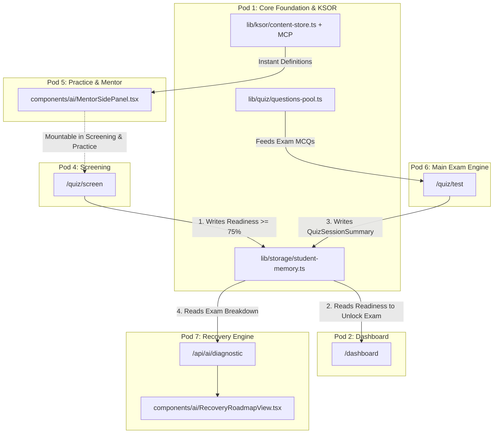

<!-- BEGIN:nextjs-agent-rules -->

## This is NOT the Next.js you know

This version has breaking changes — APIs, conventions, and file structure may all differ from your training data. Read the relevant guide in `node_modules/next/dist/docs/` (resolved from this file's directory; in monorepos the `next` package may not be visible from the repo root) before writing any code. Heed deprecation notices.

This block is written and re-added by `next dev` — verify at `node_modules/next/dist/server/lib/generate-agent-files.js`. Removing it from a diff only re-creates the uncommitted change; committing it with your work keeps the tree clean.

<!-- END:nextjs-agent-rules -->

# Mentor AI — Project Governance & Engineering Standards

> **Deadline:** Thursday 6:00 PM (Production-Ready Working Application URL)  
> **Repository Model:** Contract-First Trunk/PR Workflow  
> **Enforcement:** Every AI coding assistant and team member MUST strictly adhere to this document.

---

## 1. Project Overview & Architecture Vision

Mentor AI is an adaptive, AI-powered exam preparation platform that guides learners through a 5-step cycle:
1. **Revise:** Chapter concept review & visual mind maps.
2. **Screen:** AI Socratic screening quiz that demands and evaluates reasoning behind every answer.
3. **Practice:** Knowledge refinement with an active Mentor AI side panel for real-time explanations of business terms and concepts.
4. **Test:** Rigorous, timed exam conditions drawn from a curated MCQ pool weighted toward the student's weaknesses.
5. **Improve:** Actionable topic-wise breakdown, score analytics, and targeted AI recommendations.

### 1.1 The Strict End-to-End User Journey Workflow
Every feature and UI component must fit strictly into this sequential flow:
```
[1. Student Enters App]
        │
        ▼
[2. Dashboard: Revision Invitation]
        ├─► Explore Visual Mind Maps & Chapter Flowcharts
        └─► Enter Screening Quiz
                 │
                 ▼
[3. Socratic Screening Mode]
        ├─ Student answers MCQ + submits reasoning explanation
        ├─ AI evaluates reasoning soundness & corrects flaws
        └─ Readiness Algorithm checks score & concept mastery
                 │
                 ├─► If NOT ready: Directs back to Revision / Practice
                 └─► If READY: Unlocks "Main Test"
                             │
                             ▼
[4. Main Examination Mode (Testing Quiz)]
        ├─ Timed, strict exam conditions (no AI side panel)
        ├─ MCQs drawn from curated pool (weak topics weighted)
        └─ Student finishes exam
                 │
                 ▼
[5. Evaluation & Recovery Roadmap]
        ├─ Scorecard + MCQ topic-by-topic breakdown computed
        ├─ Results passed to Mentor AI Diagnostic Engine
        ├─ AI identifies weak chapters & generates Recovery Plan
        └─ Prescribes targeted Practice Quizzes on weak areas
```

---

## 2. The 7 Independent Verticals & Dedicated Branches (1 Developer Per Branch)

To eliminate all merge conflicts and team dependencies, the platform is divided into **7 completely decoupled vertical pods**.
- **Exactly 7 Branches**: Each branch is owned and pushed to by **1 dedicated developer**.
- **Zero Merge Clashes**: No two developers push to the same branch.
- **Contract-First**: Every vertical communicates strictly through agreed TypeScript types in `/types`.

| Pod # | Vertical Name | Dedicated Branch | Assigned Lead Developer | Scope & Files | Detailed Spec File |
| :---: | :--- | :--- | :--- | :--- | :--- |
| **Pod 1** | **Core Engine, Memory & Question Store** | `pod/1-core-engine` | **Roman Ayub** | `lib/ai/openrouter.ts`, `lib/quiz/questions-pool.ts`, `lib/storage/student-memory.ts` | `specs/POD_1_CORE_ENGINE.md` |
| **Pod 2** | **Student Dashboard & Progress Center** | `pod/2-student-dashboard` | **Laiba Imran** | `app/(student)/dashboard/page.tsx`, `components/dashboard/RevisionCard.tsx`, `components/dashboard/ReadinessBanner.tsx` | `specs/POD_2_STUDENT_DASHBOARD.md` |
| **Pod 3** | **Visual Mind Maps & Chapter Flowcharts** | `pod/3-visual-mindmaps` | **Ameena** | `app/(student)/visual-maps/page.tsx`, `components/visual/MindMapViewer.tsx`, `components/visual/ChapterFlowchart.tsx` | `specs/POD_3_VISUAL_MINDMAPS.md` |
| **Pod 4** | **Socratic Screening & Readiness Engine** | `pod/4-socratic-screening` | **Alisha Zehra** | `app/api/ai/screen/route.ts`, `app/api/ai/readiness/route.ts`, `components/ai/SocraticReasoningDialog.tsx`, `app/(student)/quiz/screen/page.tsx`, `lib/ai/readiness.ts` | `specs/POD_4_SOCRATIC_SCREENING.md` |
| **Pod 5** | **Practice Quiz & Mentor AI Side-Panel** | `pod/5-practice-quiz-mentor` | **Muskan Fayyaz** | `app/(student)/quiz/practice/page.tsx`, `components/ai/MentorSidePanel.tsx`, `app/api/ai/explain/route.ts` | `specs/POD_5_PRACTICE_MENTOR.md` |
| **Pod 6** | **Main Examination Engine & Strict Controls** | `pod/6-testing-exam-engine` | **Ubaid Raza** | `app/(student)/quiz/test/page.tsx`, `components/quiz/QuestionPalette.tsx`, `components/quiz/Timer.tsx`, `components/quiz/ProgressBar.tsx` | `specs/POD_6_TESTING_EXAM.md` |
| **Pod 7** | **Post-Test Diagnostics & Recovery Roadmap** | `pod/7-diagnostic-recovery` | **Shanzay Fatima** | `components/quiz/ExamResultsView.tsx`, `lib/ai/diagnostic.ts`, `app/api/ai/diagnostic/route.ts`, `components/ai/RecoveryRoadmapView.tsx` | `specs/POD_7_DIAGNOSTIC_RECOVERY.md` |

### 2.1 Leadership & Gatekeeper Roles
- **Team Lead Anas:** Code quality and prompt review for AI pods (Pod 1, Pod 4, Pod 5, Pod 7).
- **Team Lead Talha:** Code quality and UI/UX consistency review for interface pods (Pod 2, Pod 3, Pod 6).
- **Project Owner (You):** Overall project conductor. Merges authorized PRs into `main`. Manages `OPENROUTER_API_KEY` and deployment URL.

---

## 3. Strict Tech Stack & Tooling

Every engineer and AI assistant must use ONLY the following libraries and patterns:

| Area | Approved Technology | Prohibited Alternatives |
| :--- | :--- | :--- |
| **Framework** | **Next.js 16 (App Router)** | Pages router, Express, raw Node servers |
| **Language** | **TypeScript 5 (Strict Mode)** | Untyped JS, `any` abuse (use explicit interfaces) |
| **UI Library** | **React 19 + Tailwind CSS v4** | CSS modules, Bootstrap, styled-components |
| **Icons** | **Lucide React (`lucide-react`)** | FontAwesome, material-icons |
| **AI Provider** | **OpenRouter API** (`https://openrouter.ai/api/v1`) | Direct proprietary SDKs without OpenRouter proxy |
| **Preferred LLM Models** | **DeepSeek (`deepseek/deepseek-chat`, `deepseek/deepseek-r1`)** | Developers can specify their preferred model via `OPENROUTER_MODEL` in `.env.local` |
| **Content / Syllabus** | **Curated KSOR + Panaversity AgentFactory MCP** (`https://agentfactory.panaversity.org/`) | Unstructured hardcoded random questions in components |
| **State & Persistence** | **Typed Local/Session Storage + Sync API** | Global un-scoped state, un-validated schema writes |
| **Mind Maps & Charts** | **SVG / Tailwind Trees or React Flow (`@xyflow/react`)** | Heavy canvas libraries with build conflicts |

---

## 4. Strict Inter-Pod Handshake & Sync Protocol (The Law of Integration)

To guarantee that all 7 branches merge into `main` without missing links or broken states:



### 4.1 Integration Sync Contracts:
1. **The Readiness Contract**:
   - **Pod 4 (Screening)** MUST invoke `saveReadinessAssessment(assessment)` in `lib/storage/student-memory.ts`.
   - **Pod 2 (Dashboard)** MUST read `getStudentProfile().memory.latestReadinessAssessment?.isReadyForMainTest` to display the "Main Test Unlocked" banner.
   - **Pod 6 (Exam)** MUST verify `getStudentProfile().memory.latestReadinessAssessment?.isReadyForMainTest` before starting the test.
2. **The Examination Session Contract**:
   - **Pod 6 (Exam)** MUST invoke `recordQuizSession(summary)` upon exam submission.
   - **Pod 7 (Diagnostics)** MUST read `getStudentProfile().quizHistory` or accept `summary` prop to generate `<ExamResultsView session={summary} />` and `<RecoveryRoadmapView />`.
3. **The Mentor Side-Panel Reusability Contract**:
   - **Pod 5** exports `<MentorSidePanel isOpen={...} onToggle={...} activeQuestionTerms={...} />`.
   - **Pod 4** imports and mounts this side panel inside `/quiz/screen`.
   - **Pod 5** mounts it inside `/quiz/practice`.
4. **The KSOR & MCP Content Contract**:
   - All questions in Pod 4, Pod 5, and Pod 6 MUST be sourced from `lib/quiz/questions-pool.ts`, which synchronizes with local KSOR and Panaversity AgentFactory MCP (`https://agentfactory.panaversity.org/`).

---

## 5. Git Collaboration & Permission Matrix

### Branch Access & Merge Permissions
1. **The 7 Feature Branches**:
   - Each developer pushes ONLY to their assigned feature branch (`pod/<number>-<name>`).
   - Members have **instant, unrestricted push access** to their feature branch. No approvals needed for intermediate pushes.
2. **Main Production Branch (`main`)**:
   - Strictly protected. Direct pushes are disabled.
   - **ONLY the following 3 Gatekeepers are authorized to merge code into `main`:**
     1. **Project Owner**
     2. **Talha** (Lead - Student Interface)
     3. **Anas / Ali** (Lead - Mentor AI)
   - No other team member has merge permissions for `main`.

### Branch Naming Convention:
All team members push to their dedicated team branches:
- **Team Anas:** `ai/<feature-name>` (e.g., `ai/socratic-screening`, `ai/mentor-sidebar`, `ai/openrouter-client`)
- **Team Talha:** `ui/<feature-name>` (e.g., `ui/dashboard-history`, `ui/practice-quiz`, `ui/mindmap-viewer`)

### Pull Request & Integration Protocol:
1. When a feature is complete, a Pull Request is opened targeting `main`.
2. PR must pass `npm run build` and `npx tsc --noEmit` with 0 errors.
3. PR must be reviewed and merged exclusively by **Project Owner, Talha, or Anas/Ali**.
4. PRs must touch ONLY files within that team's ownership directory.

---

## 5. Shared Contracts (`/types`) — Law of the Repository

Both teams must strictly respect shared types in `/types`. Neither team may alter `/types/*.ts` without explicit approval from both Team Leads and the Project Owner.

### Essential Contracts:
1. `types/quiz.ts`: Definitions for `Question`, `Topic`, `QuizSession`, `QuizMode`, `AnswerSubmission`, `TopicBreakdown`.
2. `types/mentor.ts`: Definitions for `ReasoningFeedback`, `ScreeningSession`, `ReadinessScore`, `EvaluationReport`, `MentorExplanation`.
3. `types/student.ts`: Definitions for `StudentProfile`, `UserMemory`, `QuizHistoryItem`.

---

## 6. Security & Environment Configuration

- **Zero Secret Commits:** Never commit `.env` or `.env.local`. Keep them in `.gitignore`.
- **Centralized Env Provider:** All API keys (including `OPENROUTER_API_KEY`) are managed exclusively by the Project Owner.
- **Developers use `.env.example`** with mock/sandbox tokens during local development.

---

## 7. AI Assistant Directives (Cursor, Antigravity, Copilot, Claude Dev)

When coding in this repository:
1. **Never write legacy Next.js patterns** (e.g. `getStaticProps`, `getServerSideProps`). Use Server Components and App Router conventions.
2. **Always respect file ownership boundaries.** If you are generating a quiz UI, never touch `lib/ai/`. If you are writing an AI prompt, never touch `components/quiz/`.
3. **Always use TypeScript interfaces from `/types`**. Never define inline duplicate types for questions, answers, or student evaluation reports.
4. **Ensure responsive, mobile-first design** with modern Tailwind CSS styling. All components must render cleanly on mobile and desktop screens.

